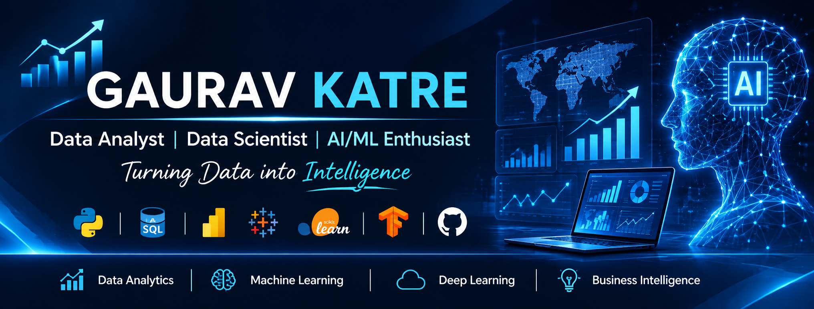

<!-- Add your generated banner image to your repository at assets/portfolio-banner.png -->

# 👋 Hi, I'm Gaurav Katre

### Data Analyst | Data Scientist | Machine Learning Enthusiast

Turning raw data into meaningful insights and building intelligent solutions using Data Analytics, Machine Learning, and Deep Learning.

---

## 🛠️ Technical Skills

| Category | Technologies & Skills |
|:---:|:---|
| **Programming** | Python, SQL |
| **Data Analysis** | Pandas, NumPy, Excel, Exploratory Data Analysis |
| **Data Visualization** | Power BI, Tableau, Matplotlib, Seaborn |
| **Database** | MySQL |
| **Statistics** | Probability, Hypothesis Testing, Correlation, Regression |
| **Data Preparation** | Data Cleaning, ETL, Feature Engineering |
| **Machine Learning** | Scikit-learn, Regression, Classification, Clustering |
| **Deep Learning** | TensorFlow, Keras, ANN, CNN, RNN, SimpleRNN |
| **Data Science** | Predictive Modeling, Model Evaluation, Statistical Analysis, Data-Driven Decision Making |
| **Tools** | Jupyter Notebook, VS Code, Git, GitHub |

---

## 🧠 Data Science & Machine Learning

- Exploratory Data Analysis (EDA)
- Data Preprocessing and Feature Engineering
- Statistical Analysis and Hypothesis Testing
- Supervised and Unsupervised Learning
- Regression and Classification Models
- Artificial Neural Networks (ANN)
- Convolutional Neural Networks (CNN)
- Recurrent Neural Networks (RNN)
- Model Training, Evaluation and Optimization

---

## 📊 Featured Projects

### 🚕 NYC Taxi Data Analysis
Large-scale taxi trip analysis using **Python and SQL** to identify trip patterns, revenue trends, peak hours, and payment behavior.

### 🏢 Retail Enterprise Customer Intelligence
Business intelligence dashboard focusing on sales performance, customer behavior, product analysis, and business insights.

### 🛒 Olist E-Commerce Business Performance
E-commerce business analysis covering orders, customers, products, sellers, revenue, and delivery performance.

### 🤖 Customer Churn Prediction Using ANN
Deep learning project using an Artificial Neural Network to predict customer churn based on customer information.

### 🎬 Movie Review Sentiment Analysis
Natural Language Processing project using Embedding and SimpleRNN to classify movie reviews as positive or negative.

### 🧠 Brain Tumor Detection Using CNN
Deep learning image classification project using Convolutional Neural Networks.

---

## 📈 GitHub Statistics

---

## 🤝 Connect With Me

[LinkedIn](https://www.linkedin.com/in/gauravkatre/) • [GitHub](https://github.com/gauravkatre55)

**Let's turn data into intelligence together! 🚀**

